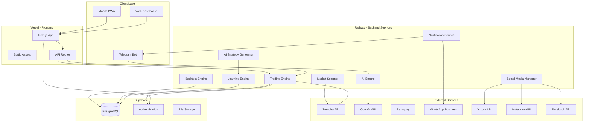

# Design Document: AIRA - AI Trading Webapp

## Overview

AIRA is a comprehensive AI-powered trading platform that combines real-time market data, automated trading execution, AI-driven strategy creation, and autonomous learning capabilities. The system operates as a full-stack web application with PWA support, deployed across Vercel (frontend), Railway (backend), and Supabase (database).

### Key Design Principles

1. **Server-Side Trading Engine**: Trading operations run independently of user sessions
2. **Scalable Architecture**: Support 1000+ concurrent users with horizontal scaling
3. **AI-First Approach**: AI learns from all platform activity to improve strategies and content
4. **Multi-Channel Communication**: Web, PWA, Telegram, WhatsApp integration
5. **Regulatory Compliance**: Clear positioning as tool provider, not advisor
6. **Real-Time Data**: Seamless data streaming with load balancing across multiple API keys

## Architecture

### High-Level Architecture



### Technology Stack

**Frontend (Vercel)**
- Framework: Next.js 14 with App Router
- UI Library: React 18
- Styling: Tailwind CSS
- State Management: Zustand
- Charts: Lightweight Charts (TradingView)
- PWA: next-pwa plugin
- Authentication: Supabase Auth + Google OAuth

**Backend (Railway)**
- Runtime: Node.js 20
- Framework: Express.js
- WebSocket: Socket.io for real-time data
- Job Queue: BullMQ with Redis
- Cron Jobs: node-cron for scheduled tasks
- AI Integration: OpenAI API (GPT-4)

**Database (Supabase)**
- Database: PostgreSQL 15
- ORM: Prisma
- Authentication: Supabase Auth
- Storage: Supabase Storage for images/files
- Real-time: Supabase Realtime for live updates

**Infrastructure**
- Version Control: GitHub
- CI/CD: GitHub Actions
- Monitoring: Sentry for error tracking
- Analytics: Vercel Analytics + Custom analytics
- Caching: Redis (Railway)

## Components and Interfaces

### 1. Frontend Components

#### Page Structure

```
app/
├── (public)/
│   ├── page.tsx                 # Landing page
│   ├── features/page.tsx        # Features page
│   ├── pricing/page.tsx         # Pricing page
│   ├── about/page.tsx           # About page
│   ├── faq/page.tsx             # FAQ page
│   ├── contact/page.tsx         # Contact page
│   ├── blog/
│   │   ├── page.tsx             # Blog listing
│   │   └── [slug]/page.tsx      # Blog post
│   ├── login/page.tsx           # Login page
│   └── signup/page.tsx          # Signup page
├── (dashboard)/
│   ├── layout.tsx               # Dashboard layout with nav
│   ├── dashboard/page.tsx       # Main dashboard
│   ├── strategy/
│   │   ├── page.tsx             # Active strategies
│   │   ├── create/page.tsx      # Create strategy
│   │   ├── private/page.tsx     # Private strategies
│   │   ├── public/page.tsx      # Public marketplace
│   │   ├── invite/page.tsx      # Invite-only strategies
│   │   └── ai/page.tsx          # AI-generated strategies
│   ├── scanner/page.tsx         # Market scanner
│   ├── analysis/page.tsx        # AI analysis
│   ├── settings/
│   │   ├── page.tsx             # Account settings
│   │   ├── api/page.tsx         # API configuration
│   │   ├── history/page.tsx     # Trading history
│   │   ├── support/page.tsx     # Support tickets
│   │   ├── notifications/page.tsx # Notification preferences
│   │   └── admin/page.tsx       # Admin panel
│   └── onboarding/page.tsx      # First-time user tour
└── api/
    ├── auth/[...nextauth]/route.ts
    ├── strategies/route.ts
    ├── trades/route.ts
    └── webhooks/
        ├── razorpay/route.ts
        └── telegram/route.ts
```

#### Key React Components

**Navigation & Layout**
- `DashboardLayout`: Main layout with sidebar navigation, header with AIRA logo, footer with disclaimers
- `Sidebar`: Navigation menu with 5 main sections (Dashboard, Strategy, Scanner, AI Analysis, Settings)
- `Header`: Logo, market status indicator, user profile dropdown, notification bell

**Dashboard Components**
- `TradeModeToggle`: Switch between Live Trade and Paper Trade
- `AITradingSwitch`: Enable/disable AI trading with risk warning modal
- `BalanceCard`: Display live trading balance with real-time updates
- `PositionsTable`: Real-time positions with P&L, sortable columns
- `OrdersTable`: Real-time orders with status, cancel functionality
- `PerformanceChart`: Daily P&L chart using Lightweight Charts

**Strategy Components**
- `StrategyCard`: Display strategy with category badge, performance metrics, activate/deactivate button
- `StrategyCreator`: Multi-step form for AI-assisted strategy creation
- `BacktestResults`: Display backtest metrics with charts (equity curve, drawdown)
- `StrategyMarketplace`: Grid of public strategies with search and filters
- `AIStrategyBadge`: Special badge for AI-generated strategies

**Scanner Components**
- `ScannerResults`: Real-time table of instruments matching strategy conditions
- `InstrumentCard`: Display instrument with current price, change %, strategy match reason

**AI Analysis Components**
- `InstrumentSearch`: Autocomplete search for instruments
- `ChartDisplay`: TradingView-style chart with indicators
- `AIInsights`: Display AI analysis with confidence scores
- `SnapshotGenerator`: Create shareable images with AIRA branding

**Settings Components**
- `APIKeyForm`: Secure form for Zerodha API credentials with TOTP setup
- `RiskSettings`: Configure daily profit/loss limits with sliders
- `NotificationMatrix`: Grid for configuring notification preferences
- `SupportTicketList`: Display tickets with status badges
- `TelegramConnect`: Display connection code and QR code
- `WhatsAppConnect`: Phone number verification with OTP

**Admin Components**
- `AdminDashboard`: Charts and metrics overview
- `UserManagement`: Table with user search, plan assignment
- `StrategyModeration`: Review and manage all strategies
- `SupportTickets`: Admin view with reply functionality
- `HealthMonitor`: Service status indicators with uptime percentages
- `SocialMediaScheduler`: Content calendar and posting controls

### 2. Backend Services

#### Trading Engine Service

**Purpose**: Execute trades independently of user sessions

**Core Functions**:
```typescript
interface TradingEngine {
  // Initialize engine with user configurations
  initialize(): Promise<void>;
  
  // Main trading loop (runs continuously during market hours)
  executeTradingCycle(): Promise<void>;
  
  // Evaluate active strategies for all users
  evaluateStrategies(userId: string): Promise<TradeSignal[]>;
  
  // Execute trade through broker API
  executeTrade(signal: TradeSignal): Promise<Trade>;
  
  // Monitor positions and apply stop-loss/targets
  monitorPositions(userId: string): Promise<void>;
  
  // Check risk limits (daily profit/loss)
  checkRiskLimits(userId: string): Promise<boolean>;
  
  // Handle market hours and holidays
  isMarketOpen(): boolean;
}
```

**Implementation Details**:
- Runs as a separate Railway service with auto-restart
- Uses BullMQ for job queue (one job per user per cycle)
- Executes trading cycle every 1 second during market hours
- Maintains in-memory cache of active strategies and positions
- Implements circuit breaker for broker API failures
- Logs all trades to database with timestamps

#### AI Engine Service

**Purpose**: Provide AI-powered analysis and strategy assistance

**Core Functions**:
```typescript
interface AIEngine {
  // Convert natural language to strategy logic
  generateStrategyFromDescription(description: string): Promise<Strategy>;
  
  // Analyze strategy and suggest improvements
  analyzeStrategy(strategy: Strategy, backtestResults: BacktestResults): Promise<StrategyImprovement>;
  
  // Analyze chart and provide insights
  analyzeChart(instrument: string, timeframe: string): Promise<ChartAnalysis>;
  
  // Generate market predictions
  generateMarketPrediction(): Promise<MarketPrediction>;
  
  // Generate educational content
  generateBlogPost(topic: string): Promise<BlogPost>;
  
  // Generate social media content
  generateSocialPost(type: 'prediction' | 'analysis' | 'tip'): Promise<SocialPost>;
}
```

**Implementation Details**:
- Uses OpenAI GPT-4 for natural language processing
- Implements prompt engineering for consistent outputs
- Caches AI responses for 1 hour to reduce API costs
- Includes system prompts with SEBI compliance disclaimers
- Validates AI-generated strategy logic before returning
- Rate limits: 100 requests per user per day

#### AI Strategy Generator Service

**Purpose**: Autonomously create profitable strategies by learning from platform data

**Core Functions**:
```typescript
interface AIStrategyGenerator {
  // Analyze all platform strategies and identify patterns
  analyzeStrategyPatterns(): Promise<StrategyPattern[]>;
  
  // Generate new strategy based on learned patterns
  generateStrategy(pattern: StrategyPattern): Promise<Strategy>;
  
  // Validate strategy meets performance criteria
  validateStrategy(strategy: Strategy, backtestResults: BacktestResults): Promise<boolean>;
  
  // Publish strategy to marketplace
  publishStrategy(strategy: Strategy): Promise<void>;
  
  // Monitor live performance of AI-generated strategies
  monitorAIStrategies(): Promise<PerformanceReport>;
}
```

**Learning Algorithm**:
1. **Data Collection**: Aggregate all strategies, backtests, and live trades
2. **Feature Extraction**: Extract features (indicators used, entry/exit conditions, timeframes)
3. **Pattern Recognition**: Use clustering to identify common patterns in profitable strategies
4. **Strategy Generation**: Combine successful patterns with variations
5. **Backtesting**: Test generated strategy on historical data
6. **Validation**: Check if meets criteria (win rate >55%, profit factor >1.5, drawdown <15%)
7. **Publication**: Publish to marketplace with "AI-Generated" label
8. **Monitoring**: Track live performance and feed back into learning loop

**Scheduled Jobs**:
- Run pattern analysis: Daily at 4:00 AM IST
- Generate new strategies: Twice weekly (Monday, Thursday at 5:00 AM IST)
- Monitor AI strategy performance: Daily at 4:30 PM IST (after market close)

#### Market Scanner Service

**Purpose**: Continuously scan instruments for strategy matches

**Core Functions**:
```typescript
interface MarketScanner {
  // Scan all instruments against active strategies
  scanMarket(): Promise<ScanResult[]>;
  
  // Evaluate single instrument against strategy
  evaluateInstrument(instrument: string, strategy: Strategy): Promise<boolean>;
  
  // Get real-time data for instrument
  getMarketData(instrument: string): Promise<MarketData>;
  
  // Notify users of scan matches
  notifyScanMatch(userId: string, result: ScanResult): Promise<void>;
}
```

**Implementation Details**:
- Scans top 500 instruments every 5 seconds during market hours
- Uses WebSocket connection to Zerodha for real-time data
- Implements load balancing across multiple Admin Data API keys
- Caches instrument data for 1 second to reduce API calls
- Sends real-time updates to frontend via Socket.io

#### Backtest Engine Service

**Purpose**: Test strategies against historical data

**Core Functions**:
```typescript
interface BacktestEngine {
  // Run backtest for strategy
  runBacktest(strategy: Strategy, params: BacktestParams): Promise<BacktestResults>;
  
  // Fetch historical data
  getHistoricalData(instrument: string, from: Date, to: Date): Promise<OHLCV[]>;
  
  // Simulate trade execution
  simulateTrade(signal: TradeSignal, marketData: OHLCV): Promise<SimulatedTrade>;
  
  // Calculate performance metrics
  calculateMetrics(trades: SimulatedTrade[]): Promise<PerformanceMetrics>;
}

interface BacktestParams {
  startDate: Date;
  endDate: Date;
  initialCapital: number;
  instruments: string[];
  slippage: number; // percentage
  commission: number; // per trade
}

interface BacktestResults {
  totalTrades: number;
  winningTrades: number;
  losingTrades: number;
  winRate: number;
  totalProfit: number;
  totalLoss: number;
  profitFactor: number;
  maxDrawdown: number;
  sharpeRatio: number;
  equityCurve: EquityPoint[];
  trades: SimulatedTrade[];
}
```

**Implementation Details**:
- Runs as background job (can take 1-5 minutes)
- Uses historical data from Zerodha API (cached in database)
- Simulates realistic execution with slippage (0.1%) and commission (₹20 per trade)
- Calculates comprehensive metrics for strategy evaluation
- Stores backtest results in database for future reference

#### Notification Service

**Purpose**: Send notifications across multiple channels

**Core Functions**:
```typescript
interface NotificationService {
  // Send notification to user via preferred channels
  sendNotification(userId: string, notification: Notification): Promise<void>;
  
  // Send email notification
  sendEmail(to: string, subject: string, body: string): Promise<void>;
  
  // Send push notification
  sendPush(userId: string, title: string, body: string): Promise<void>;
  
  // Send Telegram message
  sendTelegram(chatId: string, message: string): Promise<void>;
  
  // Send WhatsApp message
  sendWhatsApp(phoneNumber: string, message: string): Promise<void>;
  
  // Get user notification preferences
  getPreferences(userId: string): Promise<NotificationPreferences>;
}
```

**Implementation Details**:
- Checks user preferences before sending
- Respects quiet hours configuration
- Uses BullMQ for reliable delivery
- Implements retry logic (3 attempts with exponential backoff)
- Logs all notifications for audit trail
- Rate limits per channel to avoid blocking

#### Social Media Manager Service

**Purpose**: Automate social media posting for marketing

**Core Functions**:
```typescript
interface SocialMediaManager {
  // Generate and post daily content
  postDailyContent(): Promise<void>;
  
  // Post to X.com (Twitter)
  postToTwitter(content: string, image?: Buffer): Promise<string>;
  
  // Post to Instagram
  postToInstagram(content: string, image: Buffer): Promise<string>;
  
  // Post to Facebook
  postToFacebook(content: string, image?: Buffer): Promise<string>;
  
  // Generate chart image for social media
  generateChartImage(data: ChartData): Promise<Buffer>;
  
  // Track engagement metrics
  trackEngagement(postId: string, platform: string): Promise<EngagementMetrics>;
}
```

**Scheduled Jobs**:
- Generate and post content: Daily at 7:00 PM IST (after market close)
- Track engagement: Every 6 hours
- Content types rotation: Prediction (Mon, Thu), Analysis (Tue, Fri), Tips (Wed, Sat), Strategy Highlight (Sun)

**Implementation Details**:
- Uses AI Engine to generate content
- Creates branded chart images with AIRA watermark
- Includes disclaimers in all posts
- Tracks engagement via platform APIs
- Stores content calendar in database
- Admin can review/approve before posting (optional)

#### Health Monitor Service

**Purpose**: Monitor all services and infrastructure

**Core Functions**:
```typescript
interface HealthMonitor {
  // Check health of all services
  checkAllServices(): Promise<ServiceHealth[]>;
  
  // Check specific service
  checkService(serviceName: string): Promise<ServiceHealth>;
  
  // Send alerts for failures
  sendAlert(service: string, error: Error): Promise<void>;
  
  // Get uptime statistics
  getUptimeStats(service: string, period: string): Promise<UptimeStats>;
}

interface ServiceHealth {
  name: string;
  status: 'healthy' | 'degraded' | 'down';
  responseTime: number;
  lastChecked: Date;
  uptime: number; // percentage
}
```

**Monitored Services**:
- Supabase database connectivity
- Railway backend services
- Vercel frontend deployment
- Zerodha API connectivity
- OpenAI API connectivity
- Redis cache
- WebSocket connections

**Implementation Details**:
- Runs health checks every 60 seconds
- Sends immediate alerts for critical failures
- Stores health metrics in time-series database
- Displays status dashboard in Admin Panel
- Implements exponential backoff for repeated failures

### 3. Telegram Bot

**Purpose**: Provide AIRA access through Telegram

**Commands**:

```
/start - Welcome message and connection instructions
/connect <code> - Link Telegram account to AIRA
/balance - View account balance
/positions - View open positions
/strategies - List active strategies
/ai on - Enable AI trading
/ai off - Disable AI trading
/market - Check market status
/help - Show all commands
/language <en|hi> - Change language
```

**Implementation**:
- Built with node-telegram-bot-api
- Authenticates users via connection code
- Sends notifications for trades and alerts
- Supports inline keyboards for interactive responses
- Implements rate limiting (10 commands per minute)

## Data Models

### User Schema

```typescript
interface User {
  id: string; // UUID
  email: string; // unique
  passwordHash?: string; // optional for OAuth users
  name: string;
  profilePicture?: string;
  subscriptionPlan: 'basic' | 'elite' | 'pro' | 'admin';
  subscriptionExpiresAt?: Date;
  language: 'en' | 'hi';
  createdAt: Date;
  updatedAt: Date;
  
  // OAuth
  googleId?: string;
  
  // Messaging
  telegramChatId?: string;
  telegramConnected: boolean;
  whatsappNumber?: string;
  whatsappConnected: boolean;
  
  // Preferences
  notificationPreferences: NotificationPreferences;
}

interface NotificationPreferences {
  email: {
    trades: boolean;
    dailySummary: boolean;
    limits: boolean;
    systemAlerts: boolean;
    marketing: boolean;
  };
  push: { /* same structure */ };
  telegram: { /* same structure */ };
  whatsapp: { /* same structure */ };
  quietHours: {
    enabled: boolean;
    start: string; // HH:mm
    end: string; // HH:mm
  };
}
```

### API Configuration Schema

```typescript
interface AdminDataAPI {
  id: string;
  apiKey: string; // encrypted
  apiSecret: string; // encrypted
  totpSecret: string; // encrypted
  loginId: string; // encrypted
  password: string; // encrypted
  isActive: boolean;
  lastUsed: Date;
  requestCount: number; // for load balancing
  createdAt: Date;
}

interface UserAPI {
  id: string;
  userId: string; // foreign key
  broker: 'zerodha'; // future: 'upstox' | 'dhan'
  apiKey: string; // encrypted
  apiSecret: string; // encrypted
  totpSecret?: string; // encrypted, optional based on plan
  loginId?: string; // encrypted
  password?: string; // encrypted
  isConnected: boolean;
  lastLogin: Date;
  autoLogin: boolean; // based on subscription plan
  createdAt: Date;
  updatedAt: Date;
}
```

### Strategy Schema

```typescript
interface Strategy {
  id: string;
  name: string;
  description: string;
  category: 'scalping' | 'intraday' | 'swing' | 'investment';
  visibility: 'private' | 'public' | 'invite-only';
  createdBy: string; // userId or 'ai-generator'
  isAIGenerated: boolean;
  
  // Strategy Logic
  buyLogic: StrategyCondition[];
  sellLogic: StrategyCondition[];
  stopLoss: {
    buy: StopLossConfig;
    sell: StopLossConfig;
  };
  target: {
    buy: TargetConfig;
    sell: TargetConfig;
  };
  trailingStopLoss?: TrailingConfig;
  trailingTarget?: TrailingConfig;
  
  // Instruments
  instruments: string[]; // e.g., ['RELIANCE', 'TCS']
  timeframe: string; // e.g., '5m', '15m', '1h', '1d'
  
  // Performance (from backtests)
  backtestResults?: BacktestResults;
  
  // Live Performance
  liveStats?: {
    totalTrades: number;
    winRate: number;
    profitLoss: number;
    lastUpdated: Date;
  };
  
  // Access Control (for invite-only)
  invitedUsers?: string[]; // userIds
  
  createdAt: Date;
  updatedAt: Date;
}

interface StrategyCondition {
  indicator: string; // e.g., 'RSI', 'MACD', 'EMA'
  operator: '>' | '<' | '=' | '>=' | '<=' | 'crosses_above' | 'crosses_below';
  value: number | string;
  timeframe?: string;
}

interface StopLossConfig {
  type: 'fixed' | 'percentage' | 'indicator';
  value: number;
  indicator?: string;
}

interface TargetConfig {
  type: 'fixed' | 'percentage' | 'risk_reward';
  value: number;
}

interface TrailingConfig {
  enabled: boolean;
  type: 'percentage' | 'points';
  value: number;
  activationLevel: number; // profit level to activate trailing
}
```

### Trade Schema

```typescript
interface Trade {
  id: string;
  userId: string;
  strategyId: string;
  instrument: string;
  action: 'buy' | 'sell';
  quantity: number;
  entryPrice: number;
  exitPrice?: number;
  stopLoss: number;
  target: number;
  status: 'open' | 'closed' | 'cancelled';
  profitLoss?: number;
  mode: 'live' | 'paper';
  
  // Broker details
  brokerOrderId?: string;
  brokerTradeId?: string;
  
  // Timestamps
  entryTime: Date;
  exitTime?: Date;
  createdAt: Date;
  updatedAt: Date;
}
```

### Risk Settings Schema

```typescript
interface RiskSettings {
  userId: string;
  aiTradingEnabled: boolean;
  dailyProfitLimit: number; // in rupees
  dailyLossLimit: number; // in rupees
  maxPositionSize: number; // percentage of capital
  maxOpenPositions: number;
  allowedInstruments: string[];
  createdAt: Date;
  updatedAt: Date;
}
```

### Support Ticket Schema

```typescript
interface SupportTicket {
  id: string;
  ticketNumber: string; // e.g., "AIRA-2024-001"
  userId: string;
  subject: string;
  category: 'technical' | 'billing' | 'feature_request' | 'general';
  priority: 'low' | 'medium' | 'high';
  status: 'open' | 'in_progress' | 'resolved' | 'closed';
  assignedTo?: string; // admin userId
  
  messages: TicketMessage[];
  attachments: string[]; // file URLs
  
  createdAt: Date;
  updatedAt: Date;
  resolvedAt?: Date;
}

interface TicketMessage {
  id: string;
  ticketId: string;
  senderId: string; // userId
  senderType: 'user' | 'admin';
  message: string;
  isInternal: boolean; // internal notes not visible to user
  createdAt: Date;
}
```

### Blog Post Schema

```typescript
interface BlogPost {
  id: string;
  slug: string; // URL-friendly
  title: string;
  excerpt: string;
  content: string; // Markdown
  author: 'ai' | string; // userId for human authors
  category: 'education' | 'strategy' | 'analysis' | 'tips';
  tags: string[];
  featuredImage?: string;
  language: 'en' | 'hi';
  
  // SEO
  metaTitle: string;
  metaDescription: string;
  
  // Publishing
  status: 'draft' | 'published';
  publishedAt?: Date;
  
  // Engagement
  views: number;
  shares: number;
  
  createdAt: Date;
  updatedAt: Date;
}
```

### Social Media Post Schema

```typescript
interface SocialPost {
  id: string;
  platform: 'twitter' | 'instagram' | 'facebook';
  content: string;
  imageUrl?: string;
  hashtags: string[];
  
  // Scheduling
  scheduledFor: Date;
  status: 'scheduled' | 'posted' | 'failed';
  postedAt?: Date;
  
  // Platform IDs
  twitterPostId?: string;
  instagramPostId?: string;
  facebookPostId?: string;
  
  // Engagement
  likes: number;
  shares: number;
  comments: number;
  lastEngagementCheck: Date;
  
  createdAt: Date;
  updatedAt: Date;
}
```

### Analytics Schema

```typescript
interface UserAnalytics {
  userId: string;
  date: Date; // daily aggregation
  
  // Engagement
  sessionCount: number;
  sessionDuration: number; // seconds
  pagesViewed: number;
  
  // Trading
  tradesExecuted: number;
  profitLoss: number;
  strategiesActivated: number;
  
  // Features Used
  strategiesCreated: number;
  backtestsRun: number;
  scannerUsed: boolean;
  aiAnalysisUsed: boolean;
}

interface SystemMetrics {
  timestamp: Date;
  
  // Performance
  apiResponseTime: number; // ms
  databaseQueryTime: number; // ms
  tradingEngineLatency: number; // ms
  
  // Resources
  cpuUsage: number; // percentage
  memoryUsage: number; // MB
  databaseConnections: number;
  
  // Traffic
  activeUsers: number;
  requestsPerMinute: number;
  
  // Errors
  errorCount: number;
  errorRate: number; // percentage
}
```

## Correctness Properties

Before defining correctness properties, let me analyze the acceptance criteria for testability:

*A property is a characteristic or behavior that should hold true across all valid executions of a system—essentially, a formal statement about what the system should do. Properties serve as the bridge between human-readable specifications and machine-verifiable correctness guarantees.*

### Core Trading Properties

Property 1: Trading Engine Respects Risk Limits
*For any* user with configured daily profit or loss limits, when the AI Trading Engine executes trades, it should stop trading when either limit is reached and not execute additional trades until the next trading day.
**Validates: Requirements 10.2, 10.3**

Property 2: Trading Engine Operates Independently of User Sessions
*For any* user with AI Trading enabled, the Trading Engine should continue evaluating strategies and executing trades even after the user closes their browser or app, and should stop within 5 seconds when the user disables AI Trading.
**Validates: Requirements 21.2, 21.3**

Property 3: Trading Only During Market Hours
*For any* trading day, the Trading Engine should only execute trades during official market hours (9:15 AM - 3:30 PM IST) and should not execute trades on market holidays.
**Validates: Requirements 40.2**

Property 4: Balance Constraint Enforcement
*For any* trade signal, the AI Engine should only execute the trade if the user has sufficient account balance, and should reject trades that would exceed available balance.
**Validates: Requirements 10.6**

Property 5: Strategy Performance Tracking
*For any* active strategy, the system should maintain separate profit/loss calculations, and the sum of all strategy P&L should equal the total account P&L.
**Validates: Requirements 41.1**

### Data Management Properties

Property 6: API Key Load Balancing
*For any* set of configured Admin Data API keys (1-10), data requests should be distributed across all active keys such that no single key receives more than 20% more requests than any other key over a 1-hour period.
**Validates: Requirements 2.1, 2.2**

Property 7: Data Continuity During Failover
*For any* data stream, when the system switches between Admin Data API keys for load balancing, there should be no gaps in the data timeline and no duplicate data points.
**Validates: Requirements 2.3, 18.2**

Property 8: Credential Encryption Round-Trip
*For any* API credentials (Admin Data API or User API), encrypting then decrypting the credentials should produce the original values, and the encrypted form should not be reversible without the encryption key.
**Validates: Requirements 3.4, 19.1**

Property 9: Credential Isolation
*For any* API request or log entry, credentials (API keys, secrets, passwords) should never appear in plaintext in client-side code, network responses, or log files.
**Validates: Requirements 19.4**

Property 10: Real-Time State Synchronization
*For any* user action that modifies state (e.g., enabling AI trading, creating a strategy), all connected clients for that user should reflect the change within 2 seconds.
**Validates: Requirements 1.5**

### Strategy and Backtest Properties

Property 11: Strategy Visibility Access Control
*For any* strategy, users should only be able to view the full strategy logic if: (1) they created it, (2) it's marked Public, or (3) it's marked Invite-only and they're in the invited users list.
**Validates: Requirements 6.2, 6.3, 6.4**

Property 12: AI Strategy Description Parsing
*For any* natural language strategy description, the AI Engine should produce a structured Strategy object with all required fields (buyLogic, sellLogic, stopLoss, target), and the generated logic should be syntactically valid.
**Validates: Requirements 5.1**

Property 13: Automatic Backtest Execution
*For any* newly created strategy (user-created or AI-generated), the system should automatically trigger a backtest and store the results before the strategy can be activated.
**Validates: Requirements 5.4, 47.8**

Property 14: Backtest Realism
*For any* backtest execution, the final profit/loss should account for both slippage (0.1%) and commission (₹20 per trade), and these costs should reduce the gross P&L.
**Validates: Requirements 9.5**

Property 15: Backtest Metrics Completeness
*For any* completed backtest, the results should include all required metrics: total trades, win rate, profit/loss, profit factor, max drawdown, and equity curve data.
**Validates: Requirements 9.2**

Property 16: AI Strategy Quality Filter
*For any* AI-generated strategy, it should only be published to the marketplace if it meets all performance criteria: win rate > 55%, profit factor > 1.5, and max drawdown < 15%.
**Validates: Requirements 47.9**

### Scanner and Analysis Properties

Property 17: Scanner Alert Generation
*For any* instrument that meets an active strategy's entry conditions during market hours, the Scanner should generate an alert within 10 seconds of the condition being met.
**Validates: Requirements 8.2**

Property 18: AI Analysis Structure
*For any* instrument chart analysis request, the AI Engine should return an analysis object containing insights, confidence scores, and strategy-specific recommendations.
**Validates: Requirements 11.3**

Property 19: Snapshot Sharing URLs
*For any* analysis snapshot, the system should generate valid share URLs for Instagram, X.com, and Facebook that include the chart image and AIRA branding.
**Validates: Requirements 11.6**

### Authentication and Security Properties

Property 20: TOTP Code Validity
*For any* Admin Data API configuration with a TOTP secret, the generated TOTP codes should be valid according to RFC 6238 and should successfully authenticate with the broker API.
**Validates: Requirements 2.5**

Property 21: Auto-Login Success
*For any* Admin Data API or User API (with auto-login enabled) configuration, the system should successfully authenticate without manual intervention using the stored credentials and TOTP generation.
**Validates: Requirements 2.6**

Property 22: OAuth Authentication Flow
*For any* user clicking "Sign in with Google", the system should redirect to Google OAuth, receive an authorization code, exchange it for tokens, and create or link a user account.
**Validates: Requirements 49.3**

Property 23: Session Timeout
*For any* authenticated user session, if there is no activity for 30 minutes, the session should be invalidated and the user should be required to re-authenticate.
**Validates: Requirements 39.2**

Property 24: Login Rate Limiting
*For any* IP address or user account, after 5 failed login attempts within 15 minutes, subsequent login attempts should be blocked for the remainder of the 15-minute window.
**Validates: Requirements 39.6**

### Notification Properties

Property 25: Multi-Channel Notification Delivery
*For any* trade execution, position change, or limit reached event, notifications should be sent to all enabled channels (email, push, Telegram, WhatsApp) according to the user's notification preferences.
**Validates: Requirements 24.1, 50.5, 51.4**

Property 26: Notification Preference Persistence
*For any* user notification preference configuration, the settings should be persisted and applied to all future notifications until changed by the user.
**Validates: Requirements 52.3**

### Payment and Subscription Properties

Property 27: Subscription Activation on Payment
*For any* successful Razorpay payment, the user's subscription plan should be activated immediately and the subscription expiry date should be set correctly.
**Validates: Requirements 31.4**

Property 28: Webhook Processing
*For any* Razorpay webhook received, the system should verify the signature, process the payment status update, and update the user's subscription status accordingly.
**Validates: Requirements 31.9**

### Infrastructure and Monitoring Properties

Property 29: Health Check Frequency
*For any* monitored service (Supabase, Railway, Vercel, Zerodha API), health checks should execute every 60 seconds (±5 seconds) and log the results.
**Validates: Requirements 30.1**

Property 30: Database Reconnection
*For any* database connection failure, the system should attempt to reconnect with exponential backoff (1s, 2s, 4s, 8s, 16s) and restore normal operation once reconnected.
**Validates: Requirements 26.4**

Property 31: CI/CD Deployment Trigger
*For any* code push to the GitHub main branch, both Railway backend deployment and Vercel frontend deployment should be triggered within 60 seconds.
**Validates: Requirements 27.4, 28.2**

Property 32: Scalability Under Load
*For any* load test with 1000 concurrent users, the system should maintain API response times under 500ms for 95% of requests and should not crash or return errors.
**Validates: Requirements 32.1**

### Content and Compliance Properties

Property 33: SEO Meta Tags Presence
*For any* public page (landing, features, pricing, blog posts), the HTML should include meta title, meta description, Open Graph tags, and Twitter Card tags.
**Validates: Requirements 33.1**

Property 34: Compliance Language Filtering
*For any* user-facing text (UI labels, notifications, blog posts, social media), the content should not contain prohibited terms suggesting guaranteed returns, recommendations, or advisory services (e.g., "guaranteed profit", "we recommend", "investment advice").
**Validates: Requirements 25.9**

Property 35: Disclaimer Presence
*For any* page requiring disclaimers (login, signup, AI trading toggle, strategy sharing), the appropriate disclaimer text should be present and visible to users.
**Validates: Requirements 25.1**

### Social Media and Marketing Properties

Property 36: Scheduled Social Media Posting
*For any* configured posting schedule, the Social Media Manager should generate and post content to X.com, Instagram, and Facebook at the scheduled time (±5 minutes).
**Validates: Requirements 43.8**

### Support System Properties

Property 37: Support Ticket Creation
*For any* user submitting a support ticket with subject and description, the system should create a ticket with a unique ticket number, store the data, and send a confirmation email.
**Validates: Requirements 44.2**

Property 38: Admin Ticket Reply
*For any* admin reply to a support ticket, the reply should be added to the ticket conversation, the user should receive an email notification, and the ticket status should update if changed.
**Validates: Requirements 45.7**

### Configuration Properties

Property 39: Risk Limit Configuration
*For any* user setting daily profit or loss limits, the values should be persisted and applied to all future trading sessions until modified by the user.
**Validates: Requirements 13.2, 13.3**

Property 40: Admin Data API Configuration
*For any* Admin Data API configuration, the system should accept and securely store all required fields (API Key, Secret, TOTP Secret, Login ID, Password) and mark the configuration as active.
**Validates: Requirements 2.4**

## Error Handling

### Error Categories

**1. External API Failures**
- Zerodha API: Connection timeout, rate limit exceeded, authentication failure
- OpenAI API: Rate limit, invalid request, service unavailable
- Razorpay: Payment failure, webhook signature mismatch
- Social Media APIs: Authentication failure, rate limit, post rejection

**Error Handling Strategy**:
- Implement circuit breaker pattern (open after 5 consecutive failures)
- Exponential backoff for retries (1s, 2s, 4s, 8s, 16s, max 5 attempts)
- Fallback to cached data when available
- Alert administrators for critical failures
- Display user-friendly error messages

**2. Database Errors**
- Connection pool exhausted
- Query timeout
- Constraint violation
- Deadlock

**Error Handling Strategy**:
- Connection pooling with max 20 connections
- Query timeout set to 30 seconds
- Automatic retry for deadlocks (max 3 attempts)
- Graceful degradation (read-only mode if writes fail)

**3. Trading Errors**
- Insufficient balance
- Invalid instrument
- Market closed
- Order rejection by broker

**Error Handling Strategy**:
- Pre-validate all trades before submission
- Log all rejections with reason
- Notify user via configured channels
- Pause AI trading if consecutive failures exceed threshold (5)

**4. User Input Errors**
- Invalid API credentials
- Malformed strategy logic
- Invalid risk limits

**Error Handling Strategy**:
- Client-side validation before submission
- Server-side validation with detailed error messages
- Suggest corrections when possible
- Prevent submission of invalid data

### Error Logging

All errors should be logged with:
- Timestamp
- Error type and message
- Stack trace
- User ID (if applicable)
- Request context (endpoint, parameters)
- Severity level (Info, Warning, Error, Critical)

Critical errors should trigger immediate alerts to administrators via:
- Email
- Telegram
- Admin Panel notification

## Testing Strategy

### Dual Testing Approach

AIRA requires both unit testing and property-based testing for comprehensive coverage:

**Unit Tests**: Verify specific examples, edge cases, and error conditions
- Test specific strategy logic examples
- Test error handling paths
- Test integration points between components
- Test edge cases (empty inputs, boundary values)

**Property Tests**: Verify universal properties across all inputs
- Test properties hold for randomly generated data
- Minimum 100 iterations per property test
- Each property test references its design document property

### Property-Based Testing Configuration

**Framework**: fast-check (JavaScript/TypeScript)

**Test Structure**:
```typescript
import fc from 'fast-check';

// Feature: ai-trading-webapp, Property 1: Trading Engine Respects Risk Limits
test('Trading Engine stops at profit limit', () => {
  fc.assert(
    fc.property(
      fc.record({
        userId: fc.uuid(),
        dailyProfitLimit: fc.integer({ min: 1000, max: 100000 }),
        currentProfit: fc.integer({ min: 0, max: 150000 }),
      }),
      async ({ userId, dailyProfitLimit, currentProfit }) => {
        // Setup user with profit limit
        await setUserRiskSettings(userId, { dailyProfitLimit });
        
        // Simulate reaching profit
        await simulateTradingProfit(userId, currentProfit);
        
        // Verify trading stops if limit reached
        const shouldTrade = await canExecuteTrade(userId);
        if (currentProfit >= dailyProfitLimit) {
          expect(shouldTrade).toBe(false);
        }
      }
    ),
    { numRuns: 100 }
  );
});
```

**Test Coverage Requirements**:
- All 40 correctness properties must have property-based tests
- Each property test must run minimum 100 iterations
- Each test must include comment with property reference
- Unit tests for examples and edge cases identified in prework

### Integration Testing

**Critical Integration Points**:
1. Frontend ↔ Backend API
2. Trading Engine ↔ Zerodha API
3. AI Engine ↔ OpenAI API
4. Payment Flow ↔ Razorpay
5. Notification Service ↔ Telegram/WhatsApp
6. Social Media Manager ↔ Social APIs

**Integration Test Approach**:
- Use test accounts for external APIs
- Mock external services for CI/CD pipeline
- Test end-to-end flows with real integrations in staging
- Verify error handling and retry logic

### Performance Testing

**Load Testing Scenarios**:
1. 1000 concurrent users browsing dashboard
2. 100 concurrent strategy backtests
3. 500 concurrent trades during market hours
4. Real-time data streaming to 1000 clients

**Performance Targets**:
- API response time: <500ms (p95)
- Database query time: <100ms (p95)
- Trading Engine latency: <1s from signal to execution
- Real-time data delay: <500ms

### Security Testing

**Security Test Areas**:
1. SQL injection prevention
2. XSS prevention
3. CSRF protection
4. Authentication bypass attempts
5. Rate limiting effectiveness
6. Credential encryption strength
7. Session hijacking prevention

**Tools**:
- OWASP ZAP for vulnerability scanning
- Burp Suite for penetration testing
- npm audit for dependency vulnerabilities

### Monitoring and Observability

**Metrics to Track**:
- API response times (per endpoint)
- Error rates (per service)
- Trading Engine performance (trades/minute, latency)
- Database connection pool usage
- External API rate limit consumption
- User engagement (DAU, session duration)
- Revenue metrics (subscriptions, churn)

**Alerting Thresholds**:
- Error rate > 1%: Warning
- Error rate > 5%: Critical
- API response time > 1s: Warning
- Database connections > 80%: Warning
- Trading Engine stopped: Critical
- Payment processing failure: Critical

**Logging Strategy**:
- Structured logging (JSON format)
- Log levels: Debug, Info, Warning, Error, Critical
- Centralized logging with Sentry
- Log retention: 30 days
- PII redaction in logs

---

## Implementation Notes

### Phase 1: Core Infrastructure (Weeks 1-2)
- Setup Supabase database with schema
- Setup Railway backend services
- Setup Vercel frontend deployment
- Implement authentication (email/password + Google OAuth)
- Implement basic dashboard layout

### Phase 2: Trading Foundation (Weeks 3-4)
- Implement Zerodha API integration
- Implement Admin Data API management
- Implement User API configuration
- Implement Trading Engine (basic)
- Implement real-time data streaming

### Phase 3: Strategy System (Weeks 5-6)
- Implement strategy creation UI
- Implement AI-assisted strategy generation
- Implement Backtest Engine
- Implement strategy marketplace
- Implement strategy activation

### Phase 4: AI Features (Weeks 7-8)
- Implement AI Engine integration
- Implement AI Strategy Generator
- Implement Learning Engine
- Implement Market Scanner
- Implement AI Analysis page

### Phase 5: Notifications & Integrations (Weeks 9-10)
- Implement Notification Service
- Implement Telegram Bot
- Implement WhatsApp integration
- Implement email notifications
- Implement push notifications

### Phase 6: Payments & Admin (Weeks 11-12)
- Implement Razorpay integration
- Implement subscription management
- Implement Admin Panel
- Implement user management
- Implement support ticket system

### Phase 7: Marketing & Content (Weeks 13-14)
- Implement Social Media Manager
- Implement blog system
- Implement landing pages
- Implement SEO optimization
- Implement AI content generation

### Phase 8: Polish & Launch (Weeks 15-16)
- Implement PWA features
- Implement onboarding flow
- Implement multi-language support
- Performance optimization
- Security audit
- Load testing
- Beta launch

### Deployment Strategy

**Environments**:
1. Development: Local development with test APIs
2. Staging: Railway + Vercel preview with test accounts
3. Production: Railway + Vercel production with real APIs

**Deployment Process**:
1. Developer pushes to feature branch
2. GitHub Actions runs tests
3. Create pull request to main
4. Code review and approval
5. Merge to main triggers deployments
6. Automatic deployment to staging
7. Manual promotion to production after verification

**Rollback Strategy**:
- Keep last 5 deployments available for instant rollback
- Database migrations are reversible
- Feature flags for gradual rollout

### Security Considerations

**Data Encryption**:
- All API credentials encrypted at rest (AES-256)
- All data in transit uses TLS 1.3
- Database encryption enabled in Supabase

**Access Control**:
- Row Level Security (RLS) in Supabase
- JWT-based authentication
- Role-based access control (user, admin)
- API rate limiting per user

**Compliance**:
- SEBI disclaimers on all pages
- Terms of Service acceptance required
- Privacy Policy compliance
- Data retention policies
- User data export capability

### Scalability Considerations

**Horizontal Scaling**:
- Railway services can scale to multiple instances
- Stateless backend design
- Session storage in Redis
- Database connection pooling

**Caching Strategy**:
- Redis cache for frequently accessed data
- Cache market data for 1 second
- Cache AI responses for 1 hour
- Cache backtest results indefinitely

**Database Optimization**:
- Indexes on frequently queried columns
- Partitioning for large tables (trades, analytics)
- Archival of old data (>1 year)
- Read replicas for analytics queries

---

This design provides a comprehensive blueprint for building AIRA as a scalable, secure, and feature-rich AI trading platform. The architecture supports all 52 requirements while maintaining flexibility for future enhancements.
